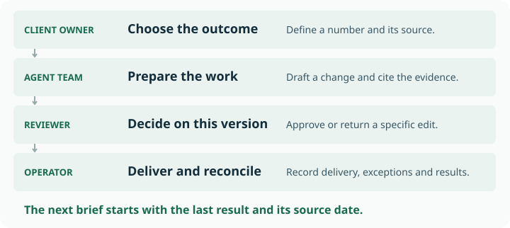

# Marketing Engineering

Marketing engineering is the work of connecting a business goal to the data, software and people who can act on it. For a service business, the question might be “Which inquiries became booked estimates?” For a marketing team, it might be “Which campaign produced signups, and how many leads never reached sales?”

This repository distills how I organize marketing work at Precision Algorithms into a new toolkit for consultants and small teams. It includes a client workspace, an offline Python command called `mktgkit`, and a worked engagement you can inspect from brief to decision. The example company and its results are fictional.

**[Run the example](#run-the-example) · [Deliver a client engagement](docs/consulting/README.md) · [Reconcile form and CRM exports](recipes/lead-handoff/README.md)**

## Run the example

With Git and Python 3.9 or later, run these commands in a terminal. Use `python` or `py` if that is how you launch Python on your machine.

```sh
git clone https://github.com/erickdronski/marketing-engineering.git
cd marketing-engineering
python3 -m mktgkit demo
```

The demo runs offline with the Python standard library. It copies a fictional client workspace, plays the writer and reviewer, and runs the real checks. In one step a writer tries to submit an unsupported claim. Later a reviewer approves a revised draft. The warehouse then reports the share of signups that can be tied to a campaign. These excerpts come from the demo:

```text
Agent · Submit an unsupported savings figure
mktgkit: 90 hours has no current signed-off claim among those cited
```

```text
Operator · Check this exact version
Allowed Q-0004 (approve_each).
```

```text
signups | with_campaign_id | share_with_campaign_id
125 | 76 | 0.608
```

Of 125 synthetic signups, 76 carried a campaign ID. The other 49 stay unattributed. A separate ad-spend export is stale. Those two facts change what a consultant can responsibly say about campaign performance. [Example workspace](examples/wrenfield) · [Warehouse and freshness rules](docs/warehouse.md)

## Build a client workspace

Install in an activated Python virtual environment from the clone. The install provides the command, blank starter and complete worked example. The runtime needs no third-party packages or AI account.

```sh
python -m pip install .
mktgkit init client-work --name "Client pilot"
mktgkit check -w client-work

mktgkit init practice --example
mktgkit warehouse build -w practice
mktgkit queue list -w practice
mktgkit queue render --out out/queue.html -w practice
```

To install a fixed version without cloning, use the [release wheel](https://github.com/erickdronski/marketing-engineering/releases/latest) in a virtual environment or run `python -m pip install "git+https://github.com/erickdronski/marketing-engineering.git@v0.1.1"`. The full consultant guide and standalone reconciliation recipe live in the repository.

Open `practice/out/queue.html` for a read-only board. Start client engagements with the blank workspace. Keep client exports, drafts and approvals in the client's access-controlled storage. [Workspace guide](docs/workspace.md) · [Engagement brief](docs/consulting/engagement-brief.md) · [Handoff checklist](docs/consulting/handoff.md)

## How the work moves

<picture>
  <source media="(prefers-color-scheme: dark)" srcset="assets/system-map-dark.svg">
  
</picture>

| Decision | Working artifact | What gets checked |
|---|---|---|
| What should change? | Goal, metric definition and batch brief | Each goal names the data source behind its measure. |
| Can we say this? | Draft plus cited claim notes | Covered numerical claims need a current signed source. Banned phrases are flagged. |
| Who reviews it? | Versioned queue item | A revision needs a new decision. Feedback must name a concrete change. |
| Can it go out? | Action and channel permission | The gate checks the reviewed version. Spend has no unattended mode. |
| What happened? | Delivery receipt, result note and warehouse export | Reports show source age. A caller can require fresh inputs before continuing. |

The orchestrator coordinates content and search work. Research, drafting, visuals and tracking have separate assignments. Ads and partnerships start parked in the example. Teams can run the workflow by hand or provide the same workspace files to an agent. [System map](docs/system-map.md) · [Review queue](docs/review-queue.md) · [Action permissions](docs/permissions.md)

## Use it in consulting work

- **Choose a channel experiment.** Pick a customer decision, copy a pilot worksheet, and see what would justify another test across creator content, Meta ads, LinkedIn, outbound, SEO, or AI search. [Channel experiment field guide](docs/consulting/channel-experiments/README.md)
- **A first pilot.** Take one form and one CRM export. Reconcile booked, unmatched and duplicate submissions. Deliver the worklist and train its owner to rerun it. [Runnable lead handoff](recipes/lead-handoff/README.md)
- **A team with multiple channels.** Agree on the denominator for campaign coverage, establish who approves copy and run the review queue for one channel before expanding. [Adoption guide](docs/adopting.md)
- **Connecting an agent or delivery tool.** The warehouse exposes read-only tools over MCP. Delivery stays with the operator or an adapter your team owns. Test its approval check, duplicate handling and receipt reconciliation before it can make a live change. [Warehouse and MCP](docs/warehouse.md) · [Adapter contract](docs/automation.md)

## Evidence and limits

The queue binds an approval to the reviewed content and records the identity supplied by the reviewer. Local files and terminal checks cannot authenticate a person. Someone with write access can edit history. A signed claim tells you which evidence a reviewer accepted; its truth still depends on that evidence. The examples measure software behavior on fictional inputs. The toolkit has no customer outcome track record yet. [Operating limits](docs/limits.md) · [Tests and contribution guide](CONTRIBUTING.md)

The idea of organizing channel agents around a shared review loop was informed by Shann Holmberg’s [How to Become a Marketing Engineer](https://x.com/shannholmberg/status/2098004743536750869). The workspace, checks, diagram and examples here are original. [MIT license](LICENSE)
